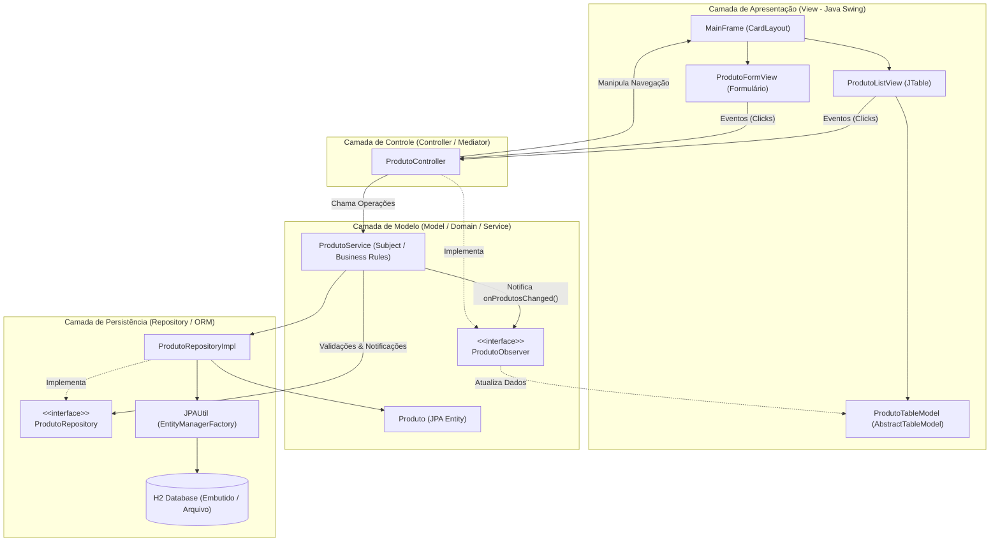
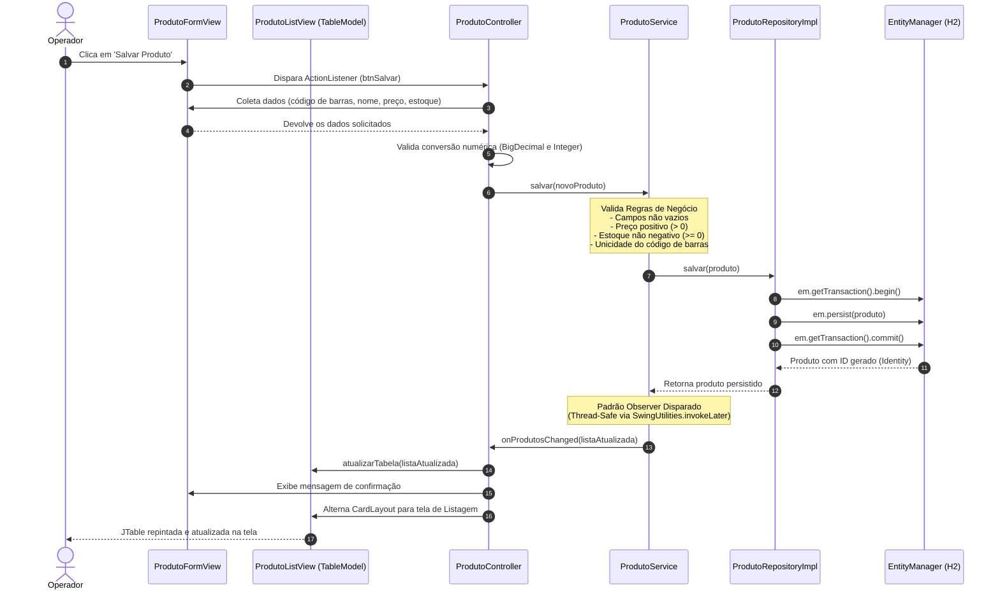
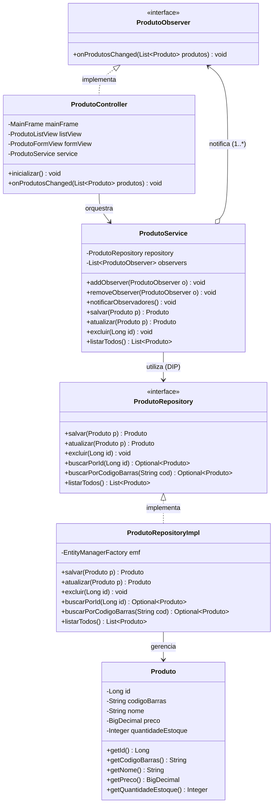

# PDV-Swing-JPA: Persistência de Dados com Frameworks de Interface Gráfica

> **Plano de Aula & Projeto Didático de Referência para Ensino Superior e Concurso Público FATEC**  
> **Instituição:** Centro Estadual de Educação Tecnológica Paula Souza (CEETEPS) — FATEC Votorantim  
> **Concurso Público:** Exame Didático — Área: Tecnologia da Informação  
> **Candidato:** Cainã Antunes Silva  
> **Curso:** Graduação em Desenvolvimento de Software Multiplataforma (DSM)  
> **Disciplina:** Técnicas de Programação II  
> **Tema da Aula:** Persistência de dados utilizando frameworks de interface gráfica  
> **Duração:** 50 minutos  

---

## 1. Identificação e Contextualização do Plano de Aula

Este projeto materializa a condução de uma aula teórico-prática de **50 minutos**, integrando a camada de apresentação desktop em **Java Swing** a um mecanismo robusto de persistência relacional com **JPA 3.1 / Hibernate 6** e banco embutido **H2 Database**. O desenvolvimento baseia-se em padrões consagrados de engenharia de software (**MVC, Observer, Repository e Inversão de Controle**), garantindo separação rigorosa de responsabilidades, reatividade de interface gráfica e segurança da informação.

### 1.1. Pré-Requisitos Curriculares
Para acompanhar esta aula, considera-se que os estudantes dominam competências consolidadas em semestres anteriores e em tópicos inaugurais desta disciplina:
- **Técnicas de Programação I (2º Semestre):** Conceitos fundamentais de Programação Orientada a Objetos (classes, encapsulamento, herança, polimorfismo, contratos de interface), tratamento de exceções e introdução à construção de interfaces gráficas.
- **Banco de Dados Relacional (2º Semestre):** Modelagem conceitual, lógica e física; integridade referencial e manipulação de dados com linguagem SQL (DDL e DML).
- **Técnicas de Programação II (Aulas Anteriores):** Fundamentos dos padrões de projeto GoF (criacionais, estruturais e comportamentais) e introdução aos padrões arquiteturais de interface com usuário (MVC, MVP e MVVM).

---

## 2. Objetivos de Aprendizagem

Ao término desta aula de 50 minutos, os discentes deverão atingir os seguintes objetivos educacionais:

### 2.1. Objetivos Cognitivos (Saber)
- **Compreender** como frameworks de interface gráfica orquestram a persistência de dados por meio da Inversão de Controle (*Inversion of Control* / *Hollywood Principle*) e da arquitetura orientada a eventos.
- **Identificar** o papel e as vantagens das ferramentas de Mapeamento Objeto-Relacional (ORM) na resolução do descompasso de impedância (*impedance mismatch*) e na prevenção de vulnerabilidades de injeção de SQL (*SQL Injection*).
- **Reconhecer** a aplicação prática dos padrões GoF *Observer* e dos padrões corporativos *MVC* e *Repository* em arquiteturas cliente desktop.

### 2.2. Objetivos Práticos / Procedimentais (Saber Fazer)
- **Conectar** a camada de apresentação visual construída em Java Swing a um repositório de dados mediado por JPA/Hibernate e banco de dados H2.
- **Implementar** a sincronização reativa de dados entre modelos de tabela (`AbstractTableModel`) e componentes visuais (`JTable`) utilizando eventos desacoplados do padrão *Observer*.

### 2.3. Objetivos Atitudinais (Ser / Agir)
- **Demonstrar pensamento crítico** na seleção e estruturação de camadas de software, valorizando boas práticas de código limpo, desacoplamento arquitetural e segurança da informação no ciclo de vida dos dados corporativos.

---

## 3. Conteúdo Programático

1. **Contexto de Persistência em Aplicações Gráficas:** A ação do usuário como gatilho do ciclo de vida dos dados; Inversão de Controle (IoC) em frameworks de GUI.
2. **Padrão Arquitetural MVC e Desacoplamento:** Fronteiras e contratos entre visualização (`View`), orquestração (`Controller`) e dados/regras de domínio (`Model`).
3. **Padrões de Projeto Aplicados ao Framework e à Persistência:**
   - **Observer (GoF):** `ActionListener` (captura na GUI) e `ProdutoObserver` / `fireTableDataChanged` (sincronização reativa de tela).
   - **Repository:** Abstração da coleção de entidades em memória e isolamento das operações de banco de dados.
4. **Camada ORM (JPA/Hibernate) & Banco Embutido:** Mapeamento declarativo de entidades (`@Entity`, `@Table`, `@Id`), controle transacional atômico (`commit`/`rollback`) e execução segura de transações sobre o H2 Database.
5. **Estudo de Caso Norteador:** Apresentação arquitetural e de código do módulo de Cadastro e Gestão de Produtos (Módulo PDV).

---

## 4. Estratégias Pedagógicas e Metodologia

A condução didática fundamenta-se na articulação entre o **Estudo de Caso Norteador**, a **Demonstração Conceitual Dirigida** e a **Aprendizagem Baseada em Projetos (PBL - Project-Based Learning)**:

- **Contextualização e Situação-Problema (Abertura):** A aula parte de uma demanda real do mercado de trabalho — o gerenciamento de retaguarda de produtos em um Ponto de Venda (PDV) — para instigar a reflexão sobre os vícios clássicos da programação desktop: mistura de comandos SQL dentro de eventos de clique de botões (`JButton`), telas que congelam e ausência de tratamento de transações.
- **Demonstração Conceitual Dirigida (Desenvolvimento):** Utilização do miniprojeto funcional como fio condutor para desconstruir e analisar trechos de código em conjunto com os fundamentos teóricos que eles materializam (arquitetura MVC, padrões GoF e ciclo de persistência com ORM).
- **Engajamento Ativo via PBL (Próximos Passos):** Lançamento de um desafio de desenvolvimento prático a ser executado em equipe nas aulas subsequentes, utilizando o repositório-base disponibilizado no GitHub como matriz inicial para a expansão de um PDV setorial completo.

---

## 5. Diagramas Arquiteturais (Mermaid)

### 5.1. Visão Geral da Arquitetura em Camadas (MVC Puro)



---

### 5.2. Diagrama de Sequência: Fluxo "Salvar Produto"

O diagrama a seguir detalha o ciclo de vida completo do cadastro de um produto, desde a interação do usuário na interface gráfica até a persistência no banco e a atualização reativa da tabela:



---

### 5.3. Diagrama de Classes: Padrões Repository & Observer



---

## 6. Justificativa Pedagógica do Stack Tecnológico

| Tecnologia / Decisão | Justificativa Didática |
| :--- | :--- |
| **Java 17+ (LTS)** | Linguagem padrão em instituições de ensino técnico e superior, fornecendo estabilidade corporativa aliada a recursos modernos da linguagem. |
| **Jakarta Persistence (JPA 3.1) & Hibernate 6.x** | Demonstra a separação fundamental entre **especificação padrão** (`jakarta.persistence.*`) e **provedor de implementação** (`org.hibernate.*`). Ensina aos alunos o paradigma ORM, ciclo de vida de entidades (*transient, managed, detached*), mapeamento de constraints e transações atômicas ACID sem acoplamento a SQL proprietário. |
| **H2 Database (Embutido / Arquivo)** | **Zero-Configuration:** Elimina a necessidade de servidores de banco externos (MySQL/PostgreSQL/Docker), permitindo que bancas examinadoras e estudantes executem a aplicação imediatamente. Os dados persistem no diretório local `./data/pdv_db.mv.db`. |
| **Java Swing (Código Puro)** | Permite ao docente demonstrar a engenharia de componentes visuais (`JFrame`, `JPanel`), gerenciadores de layout (`CardLayout`, `GridBagLayout`, `BorderLayout`) e o controle rigoroso da **Event Dispatch Thread (EDT)**. |
| **FlatLaf Look & Feel** | Proporciona estética moderna e profissional à aplicação desktop, superando o aspecto arcaico dos temas tradicionais do Java. |
| **Maven Wrapper (`mvnw` / `mvnw.cmd`)** | Assegura reproducibilidade estrita de compilação e execução em qualquer plataforma (Windows, Linux, macOS), sem depender de instalação prévia do Maven no sistema operacional. |

---

## 7. Estrutura do Projeto

```text
exemplo_persistencia_JavaSwing/
├── .mvn/wrapper/                 # Binários e configuração do Maven Wrapper
├── data/                         # Arquivos de banco de dados H2 gerados em tempo de execução
├── src/
│   ├── main/
│   │   ├── java/br/gov/sp/cps/fatec/pdv/
│   │   │   ├── Main.java                        # Ponto de entrada (Bootstrap, Pure DI e Look&Feel)
│   │   │   ├── controller/
│   │   │   │   └── ProdutoController.java       # Orquestrador MVC e ouvinte Observer
│   │   │   ├── model/
│   │   │   │   ├── entity/
│   │   │   │   │   └── Produto.java             # Entidade JPA mapeada para tabela 'produtos'
│   │   │   │   ├── observer/
│   │   │   │   │   └── ProdutoObserver.java     # Interface funcional do padrão Observer
│   │   │   │   ├── repository/
│   │   │   │   │   ├── ProdutoRepository.java   # Abstração de persistência (Interface)
│   │   │   │   │   └── ProdutoRepositoryImpl.java # Implementação com JPA / EntityManager
│   │   │   │   └── service/
│   │   │   │       └── ProdutoService.java      # Regras de negócio, unicidade e Subject Observer
│   │   │   ├── util/
│   │   │   │   └── JPAUtil.java                 # Gerenciador Singleton do EntityManagerFactory
│   │   │   └── view/
│   │   │       ├── MainFrame.java               # Janela com CardLayout para alternância de telas
│   │   │       ├── ProdutoFormView.java         # Formulário de cadastro/edição com GridBagLayout
│   │   │       ├── ProdutoListView.java         # Tabela de dados com JTable e ações CRUD
│   │   │       └── tablemodel/
│   │   │           └── ProdutoTableModel.java   # Modelo de tabela reativo (AbstractTableModel)
│   │   └── resources/
│   │       └── META-INF/
│   │           └── persistence.xml              # Configuração JPA para banco H2 e testes
│   └── test/java/br/gov/sp/cps/fatec/pdv/
│       ├── model/repository/
│       │   └── ProdutoRepositoryTest.java       # Teste de persistência e operações CRUD
│       └── model/service/
│           └── ProdutoServiceTest.java          # Teste de validações de negócio e Observer
├── pom.xml                                      # Descritor do Maven e dependências
├── mvnw / mvnw.cmd                              # Scripts executáveis do Maven Wrapper
└── README.md                                    # Plano de aula e documentação técnica integrada
```

---

## 8. Como Compilar e Executar

### Pré-requisitos
- **Java JDK 17** ou superior instalado (`java -version`).
- Acesso à internet na primeira execução para download automático de dependências pelo Maven Wrapper.

### 8.1. Execução via Maven Wrapper (Modo Desenvolvimento)

No terminal, posicionado na raiz do projeto:

#### No Windows (PowerShell / CMD):
```powershell
# Executar a aplicação diretamente pelo Maven Wrapper:
.\mvnw.cmd compile exec:java -Dexec.mainClass="br.gov.sp.cps.fatec.pdv.Main"
```

#### No Linux / macOS (Bash / Zsh):
```bash
./mvnw compile exec:java -Dexec.mainClass="br.gov.sp.cps.fatec.pdv.Main"
```

---

### 8.2. Compilação, Testes e Geração do Pacote JAR (Produção)

Para executar a suíte completa de testes automatizados e empacotar o projeto em um arquivo JAR executável autossuficiente:

```powershell
# Limpar, testar e empacotar:
.\mvnw.cmd clean package
```

Após o término com `BUILD SUCCESS`, execute o artefato gerado:

```powershell
# Execução do executável empacotado:
java -jar target/exemplo_persistencia_JavaSwing-1.0.0.jar
```

---

### 8.3. Execução Direta via IDE (VS Code, IntelliJ IDEA, Eclipse ou NetBeans)
1. Abra a pasta do projeto como um projeto Maven existente na sua IDE preferida.
2. Aguarde a indexação das dependências do `pom.xml`.
3. Navegue até o arquivo `src/main/java/br/gov/sp/cps/fatec/pdv/Main.java`.
4. Clique com o botão direito e selecione **Run 'Main.main()'**.

---

## 9. Cronograma e Desenvolvimento da Aula (50 Minutos)

Este cronograma detalha a articulação didática entre exposição teórica, inspeção de código e demonstração funcional diante da Banca Examinadora:

| Etapa | Tempo | Estratégia Pedagógica | Conteúdo Programático Desenvolvido |
| :---: | :---: | :--- | :--- |
| **1. Abertura e Situação-Problema** | 00min a 10min | Estudo de Caso Norteador e Contextualização Curricular | Apresentação pessoal, articulação com TP-I e Banco de Dados (PPC), objetivos de aprendizagem (CHA). Introdução à situação-problema do PDV comercial e riscos de acoplar telas a comandos SQL. |
| **2. Fundamentação Teórica e Arquitetura** | 10min a 25min | Exposição Conceitual Dialogada com Diagramas | Persistência de dados (RAM vs. Disco / ACID), caracterização do Java Swing com IoC, arquitetura MVC (SoC), revisão formal do padrão Observer (GoF), Repository (DDD) e funcionamento do ORM (JPA/Hibernate) para resolução do *impedance mismatch*. Apresentação da *stack* do projeto. |
| **3. Inspeção da Implementação (Estudo de Caso)** | 25min a 45min | Demonstração Dirigida de Código guiada por Diagrama de Sequência | Condução passo a passo do fluxo "Cadastrar Novo Produto" integrando teoria e prática:<br>• **View → Controller:** Captura de eventos (`ActionListener`) e sanitização de dados.<br>• **Controller → Model:** Validação de domínio em `ProdutoService`.<br>• **Model → Persistência:** Execução de transação ACID no `ProdutoRepositoryImpl` via ORM (`EntityManager` / H2).<br>• **Sincronização Reativa:** Disparo do padrão Observer na EDT do Swing (`fireTableDataChanged`) e repintura da `JTable`. |
| **4. Síntese e Fechamento** | 45min a 48min | Síntese Integradora e Validação Formativa | Recapitulação do fluxo integrado (Interface → Padrões → Persistência Segura) e abertura da sessão para arguição da Comissão Julgadora. |
| **5. Proposição Prática e PBL** | 48min a 50min | Aprendizagem Baseada em Projetos (PBL) | Apresentação do repositório público no GitHub, proposta de extensão do núcleo PDV em equipes multidisciplinares (novas entidades e telas) e explicitação da rubrica de avaliação formativa. |

---

## 10. Avaliação da Aprendizagem e Proposta Prática (PBL)

Para consolidar as competências da disciplina, os estudantes utilizarão o repositório Git do projeto demonstrado (**PDV Core**) como matriz arquitetural inicial.

### 10.1. O Desafio Prático
Em equipes, os estudantes deverão estender a base do projeto para conceber e implementar um sistema completo de PDV aplicado a um **nicho de mercado** à escolha do grupo (ex.: farmácia, livraria, autopeças, pet shop).

### 10.2. Requisitos de Expansão
1. **Modelagem e Mapeamento ORM:** Criação de novas entidades e relacionamentos mapeados com JPA (ex.: `Cliente`, `Venda`, `ItemVenda`).
2. **Interface Gráfica Desacoplada:** Implementação das respectivas telas e tabelas Swing respeitando a separação MVC e a sincronização reativa com o padrão Observer.
3. **Regras de Negócio e Transações:** Tratamento de transações atômicas de vendas com validação de estoque e controle de exceções na camada Repository.
4. **Engenharia e Colaboração:** Utilização rigorosa de versionamento colaborativo com Gitflow e commits semânticos.

### 10.3. Critérios de Avaliação (Rubrica de Desempenho)
- **Aderência Arquitetural (MVC):** Rigor na separação de responsabilidades (a View não acessa o banco; o Controller apenas orquestra; a persistência é isolada no Repository).
- **Aplicação de Padrões de Projeto (GoF / Repository):** Utilização correta dos padrões Observer para atualização de interfaces e contratos de interface desacoplados.
- **Qualidade e Segurança da Persistência:** Mapeamento ORM coerente, integridade de transações (`commit`/`rollback`) e ausência de vulnerabilidades de SQL Injection.
- **Usabilidade e Sincronização da Interface:** Interface funcional, responsiva e com atualização consistente dos dados na tabela após operações de CRUD.
- **Processo de Engenharia e Versionamento:** Histórico de commits coerente, documentação técnica (`README.md` com diagramas) e divisão colaborativa de tarefas no Gitflow.

---

## 11. Recursos Didáticos

- **Quadro branco e marcadores:** Para esquematização visual e dedução dos fluxos arquiteturais durante a introdução teórica.
- **Projeção multimídia institucional:** Para exibição dos diagramas conceituais (Mermaid) e demonstração dirigida do código-fonte.
- **Plano de aula impresso:** Entregue em 3 vias à Comissão Julgadora do Concurso Público.
- **Repositório de controle de versão (GitHub):** Roteiro e esqueleto do projeto disponibilizados aos estudantes como ponto de partida da atividade prática.

---

## 12. Referências Bibliográficas

- **FREEMAN, Eric; FREEMAN, Elisabeth.** *Use a Cabeça! Padrões de Projetos.* 2. ed. Rio de Janeiro: Alta Books, 2007.
- **GAMMA, Erich; HELM, Richard; JOHNSON, Ralph; VLISSIDES, John.** *Padrões de Projetos: Soluções Reutilizáveis de Software Orientados a Objetos.* Porto Alegre: Bookman, 2015.
- **GUERRA, Eduardo.** *Design Patterns com Java: Projeto Orientado a Objetos guiado por Padrões.* São Paulo: Casa do Código, 2014.
- **SIERRA, Kathy; BATES, Bert.** *Use a Cabeça! Java.* 2. ed. São Paulo: O'Reilly / Alta Books, 2005.
- **ANDRADE, S. S.** *Aprenda Java EE 8: Aplicações Para Web com Spring MVC e Hibernate.* São Paulo: SENAI-SP Editora, 2018.
- **ELMASRI, Ramez; NAVATHE, Shamkant B.** *Sistemas de Banco de Dados.* 7. ed. São Paulo: Pearson, 2018.
- **ECLIPSE FOUNDATION.** *Jakarta Persistence (JPA) Specification 3.1.* Disponível em: <https://jakarta.ee/specifications/persistence/>. Acesso em: 11 out. 2026.
- **H2 DATABASE ENGINE.** *H2 Database Engine Architecture and Documentation.* Disponível em: <http://www.h2database.com/html/main.html>. Acesso em: 11 out. 2026.
- **HIBERNATE COMMUNITY.** *Hibernate ORM User Guide.* Disponível em: <https://hibernate.org/orm/documentation/>. Acesso em: 11 out. 2026.
- **ORACLE CORPORATION.** *Java Platform, Standard Edition (Java SE) Documentation: Package javax.swing.* Disponível em: <https://docs.oracle.com/en/java/javase/>. Acesso em: 11 out. 2026.

---

## 13. Histórico de Versões e Gitflow

O repositório foi construído seguindo o modelo **Gitflow** e convenções de **Conventional Commits**:

- `main`: Branch estável contendo a versão consolidada para demonstração e produção.
- `develop`: Branch de integração contínua das novas funcionalidades.
- `feature/setup-and-persistence`: Configuração Maven, JPA Hibernate 6, H2 Database, Entidade `Produto`, Repositório e testes unitários.
- `feature/views-and-tablemodel`: Construção dos componentes visuais Swing (`ProdutoTableModel`, `ProdutoFormView`, `ProdutoListView`, `MainFrame`).
- `feature/controller-and-observer`: Implementação da orquestração do `ProdutoController`, serviço de validações `ProdutoService` e sincronização via `ProdutoObserver`.
- `docs/didactic-documentation`: Elaboração completa da documentação pedagógica, plano de aula para exame didático e diagramas arquiteturais.

---

**Centro Estadual de Educação Tecnológica Paula Souza — FATEC Votorantim**  
*Curso de Desenvolvimento de Software Multiplataforma | Técnicas de Programação II*  
*Prof. Cainã Antunes Silva*
