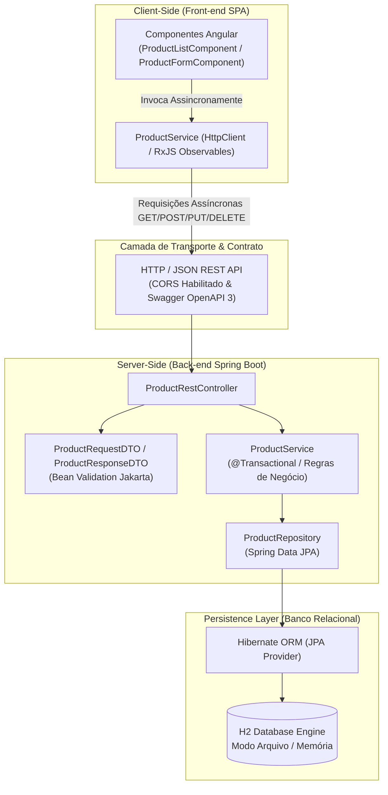

# PDV Core - Sistema de Gestão de Produtos

[](https://github.com)
[](https://github.com)
[](https://adoptium.net)
[](https://spring.io/projects/spring-boot)
[](https://angular.dev)
[](https://www.docker.com)
[](LICENSE)

Aplicação web moderna, desacoplada e distribuída para catálogo e controle de inventário de produtos no subsistema de Ponto de Venda (PDV). O sistema implementa persistência relacional transacional sob garantias ACID e interface de usuário reativa orientada a eventos e requisições HTTP assíncronas não-bloqueantes.

---

## 1. Visão Geral e Propósito do Sistema

O **PDV Core** foi refatorado a partir de uma arquitetura desktop monolítica para um modelo cliente-servidor desacoplado estruturado em monorepo:

* **Back-end RESTful (Spring Boot 3):** Encapsula a lógica de negócio transacional, expõe contratos de comunicação estruturados em JSON, valida a integridade de dados na entrada via Bean Validation (Jakarta) e gerencia a persistência relacional através do Spring Data JPA / Hibernate ORM sobre o banco H2.
* **Front-end SPA Reativo (Angular):** Interface reativa de alta performance construída com componentes standalone, gerenciamento de estado local, roteamento declarativo e comunicação assíncrona orientada a Observables via `HttpClient`.
* **DevOps & Automação:** Infraestrutura 100% conteinerizada com Docker e Docker Compose, aliada a pipelines independentes de Integração e Entrega Contínua (CI/CD) no GitHub Actions voltadas para deploy PaaS/Edge (Render e Vercel).

---

## 2. Arquitetura da Solução

A solução adota uma divisão rigorosa em camadas com baixo acoplamento e alta coesão:



### Detalhamento das Camadas

1. **Client-Side (Angular SPA):**
   * **Componentes Standalone:** Isolamento de responsabilidade entre listagem tabular (`ProductListComponent`) e formulário reativo de edição/cadastro (`ProductFormComponent`).
   * **Serviço Assíncrono (`ProductService`):** Comunicação não-bloqueante baseada em RxJS com tipagem estrita via interface TypeScript `Product`.
   * **Design Tokens & Acessibilidade:** Interface construída com design limpo, tipografia moderna (*Inter*), estados visuais reativos (*spinners*, *toasts*, bordas de validação dinâmica) e layout responsivo.

2. **API Gateway / Camada de Transporte:**
   * **Contrato RESTful Canônico:** Rotas padronizadas sob `/api/products` com tráfego bidirecional em JSON.
   * **CORS Configurado:** Habilitado para consumo seguro por navegadores web em origens desacopladas.
   * **Documentação Viva:** Contrato interativo OpenAPI 3 documentado via Swagger UI em `/swagger-ui.html`.

3. **Server-Side (Spring Boot 3):**
   * **Controllers REST:** Serialização automatizada, injeção de dependências e códigos de status HTTP semânticos (`200 OK`, `201 Created`, `204 No Content`, `400 Bad Request`, `404 Not Found`).
   * **DTOs com Validação Declarativa:** `@NotBlank`, `@NotNull`, `@DecimalMin`, `@Min` garantem consistência antes de atingir a regra de negócio.
   * **Camada de Serviço Transacional:** `@Transactional` assegura atomicidade e consistência (ACID) na validação de unicidade de código de barras e integridade dos registros.
   * **Repositório Desacoplado:** `ProductRepository` estende `JpaRepository`, eliminando dependência direta de código boilerplate de `EntityManager`.

4. **Persistence Layer (Hibernate / H2):**
   * Mapeamento objeto-relacional automático sobre a tabela relacional `products`.
   * Suporte tanto a banco baseado em arquivo (`./data/pos_db`) para persistência local quanto em memória (`mem:pos_test_db`) para suíte de testes.

---

## 3. Tecnologias Utilizadas (Tech Stack)

### Back-end
* **Linguagem & Runtime:** Java 17 LTS (OpenJDK Temurin)
* **Framework Central:** Spring Boot 3.2.5
* **Persistência & Dados:** Spring Data JPA, Hibernate ORM 6.4
* **Banco de Dados Relacional:** H2 Database Engine 2.2
* **Validação de Entrada:** Jakarta Bean Validation (Hibernate Validator)
* **Documentação de API:** Springdoc OpenAPI Starter WebMvc UI 2.3.0
* **Build & Dependências:** Apache Maven 3.9 (Maven Wrapper incluso)
* **Testes Automatizados:** JUnit 5, AssertJ, Spring Boot Test Slice

### Front-end
* **Framework:** Angular 17+ (Componentes Standalone)
* **Linguagem:** TypeScript 5.4+
* **Programação Reativa:** RxJS 7.8+
* **Cliente HTTP:** Angular `HttpClient` com suporte a `withFetch`
* **Estilização:** CSS Moderno com Design Tokens, Flexbox/Grid e animações fluidas
* **Internacionalização:** Suporte a formatação monetária brasileira (`pt-BR` / Real R$)

### DevOps & Infraestrutura
* **Conteinerização:** Docker Engine & Docker Compose (Multi-stage builds)
* **Servidor Web SPA:** NGINX Alpine Linux
* **CI/CD:** GitHub Actions (workflows paralelos com detecção de path)
* **PaaS Back-end:** Render (Web Service Docker/Java)
* **Edge Front-end:** Vercel (Edge Network com SPA Rewrites)

---

## 4. Estrutura do Repositório (Monorepo)

```
.
├── .github/
│   └── workflows/
│       ├── backend-ci.yml           # Pipeline de build, testes JUnit e trigger no Render
│       └── frontend-ci.yml          # Pipeline de linting, build Angular e deploy na Vercel
├── backend/
│   ├── src/
│   │   ├── main/
│   │   │   ├── java/br/gov/sp/fatec/pos/
│   │   │   │   ├── PosWebApplication.java         # Classe principal Spring Boot
│   │   │   │   ├── config/
│   │   │   │   │   ├── CorsConfig.java            # Configuração de CORS para SPA
│   │   │   │   │   └── OpenApiConfig.java         # Metadados do OpenAPI / Swagger
│   │   │   │   ├── controller/
│   │   │   │   │   └── ProductRestController.java # Endpoints RESTful
│   │   │   │   ├── dto/
│   │   │   │   │   ├── ProductRequestDTO.java     # Payload validado de entrada
│   │   │   │   │   └── ProductResponseDTO.java    # Representação pública do produto
│   │   │   │   ├── entity/
│   │   │   │   │   └── Product.java               # Entidade JPA mapeada
│   │   │   │   ├── exception/
│   │   │   │   │   └── GlobalExceptionHandler.java# Interceptador global de erros HTTP
│   │   │   │   ├── repository/
│   │   │   │   │   └── ProductRepository.java     # Repositório Spring Data JPA
│   │   │   │   └── service/
│   │   │   │       └── ProductService.java        # Regras de negócio e transações
│   │   │   └── resources/
│   │   │       └── application.yml                # Configuração do DataSource e Swagger
│   │   └── test/
│   │       ├── java/br/gov/sp/fatec/pos/service/
│   │       │   └── ProductServiceTest.java        # Testes de integração e domínio
│   │       └── resources/
│   │           └── application.yml                # Configuração para banco H2 em memória
│   ├── Dockerfile                                 # Multi-stage build Maven + JRE 17
│   ├── mvnw / mvnw.cmd                            # Maven Wrapper
│   └── pom.xml                                    # Descritor Maven do Back-end
├── frontend/
│   ├── src/
│   │   ├── app/
│   │   │   ├── core/
│   │   │   │   ├── models/product.model.ts        # Interface TypeScript
│   │   │   │   └── services/product.service.ts    # Chamadas assíncronas HttpClient
│   │   │   ├── pages/
│   │   │   │   ├── product-list/                  # Tela 1: Listagem tabular de produtos
│   │   │   │   └── product-form/                  # Tela 2: Cadastro e edição reativa
│   │   │   ├── app.ts / app.html / app.css        # Shell principal e navbar
│   │   │   ├── app.config.ts                      # Provedores (Router, HttpClient)
│   │   │   └── app.routes.ts                      # Rotas da aplicação
│   │   ├── environments/
│   │   │   ├── environment.ts                     # URL da API em desenvolvimento
│   │   │   └── environment.prod.ts                # URL da API em produção
│   │   ├── styles.css                             # Design System global
│   │   └── index.html                             # Página base SPA
│   ├── Dockerfile                                 # Multi-stage build Node + NGINX
│   ├── nginx.conf                                 # Configuração NGINX para SPA
│   ├── package.json                               # Dependências Node.js
│   ├── angular.json                               # Configurações do Angular CLI
│   └── vercel.json                                # Regras de reescrita SPA para Vercel
├── docker-compose.yml                             # Orquestração local dos dois serviços
└── README.md                                      # Documentação técnica do projeto
```

---

## 5. Guia de Instalação e Execução Local

### Pré-requisitos
* **Java Development Kit (JDK):** Versão 17 ou superior instalada.
* **Node.js:** Versão 20 LTS ou superior com npm.
* **Docker & Docker Compose:** Instalados e em execução no sistema operacional (opcional para execução conteinerizada).

---

### Opção 1: Execução Rápida via Docker Compose (Recomendada)

Para orquestrar e subir ambos os serviços conteinerizados com um único comando na raiz do projeto:

```bash
docker compose up --build
```

Após a inicialização dos contêineres:
* **Front-end SPA:** Acesse em [http://localhost:80](http://localhost:80)
* **Back-end REST API:** Acesse em [http://localhost:8080](http://localhost:8080)
* **Swagger UI:** Acesse em [http://localhost:8080/swagger-ui.html](http://localhost:8080/swagger-ui.html)
* **H2 Console:** Acesse em [http://localhost:8080/h2-console](http://localhost:8080/h2-console)

Para interromper os serviços:
```bash
docker compose down
```

---

### Opção 2: Execução Manual em Ambiente de Desenvolvimento

#### Passo 1: Executar o Back-end (Spring Boot)

Navegue até a pasta `backend/` e inicie a aplicação com o Maven Wrapper:

* **Linux / macOS:**
  ```bash
  cd backend
  chmod +x mvnw
  ./mvnw spring-boot:run
  ```

* **Windows (PowerShell / CMD):**
  ```powershell
  cd backend
  .\mvnw.cmd spring-boot:run
  ```

O servidor iniciará na porta **8080** conectando-se ao banco H2 local em `./data/pos_db`.

#### Passo 2: Executar o Front-end (Angular SPA)

Abra outro terminal, navegue até a pasta `frontend/`, instale os pacotes npm e inicie o servidor de desenvolvimento:

```bash
cd frontend
npm install
npm start
```

O servidor de desenvolvimento do Angular iniciará por padrão em [http://localhost:4200](http://localhost:4200), consumindo diretamente a API local em `http://localhost:8080`.

---

## 6. Documentação Interativa da API (Swagger / OpenAPI)

Com o back-end em execução, a documentação formal e interativa gerada pelo Springdoc OpenAPI pode ser acessada em:

👉 **[http://localhost:8080/swagger-ui.html](http://localhost:8080/swagger-ui.html)**

A especificação OpenAPI em formato JSON bruto está disponível em:
👉 **[http://localhost:8080/api-docs](http://localhost:8080/api-docs)**

### Resumo de Endpoints RESTful

| Verbo HTTP | Endpoint | Descrição | Status Sucesso | Status Erro |
| :--- | :--- | :--- | :--- | :--- |
| `GET` | `/api/products` | Retorna lista completa de produtos | `200 OK` | `500 Internal Error` |
| `GET` | `/api/products/{id}` | Busca produto pelo identificador | `200 OK` | `404 Not Found` |
| `POST` | `/api/products` | Cadastra novo produto com validações | `201 Created` | `400 Bad Request` |
| `PUT` | `/api/products/{id}` | Atualiza dados de um produto existente | `200 OK` | `400 Bad Request`, `404 Not Found` |
| `DELETE` | `/api/products/{id}` | Exclui permanentemente um produto | `204 No Content` | `404 Not Found` |

### Exemplo de Payload de Requisição (`POST / PUT /api/products`)

```json
{
  "barcode": "7891234567890",
  "name": "Teclado Mecânico RGB Switch Blue",
  "price": 289.90,
  "stockQuantity": 25
}
```

### Exemplo de Resposta (`201 Created` / `200 OK`)

```json
{
  "id": 1,
  "barcode": "7891234567890",
  "name": "Teclado Mecânico RGB Switch Blue",
  "price": 289.90,
  "stockQuantity": 25
}
```

### Acesso ao Console Web do Banco de Dados H2

Para inspecionar diretamente as tabelas físicas do banco de dados relacional:

* **URL de Acesso:** [http://localhost:8080/h2-console](http://localhost:8080/h2-console)
* **JDBC URL:** `jdbc:h2:file:./data/pos_db`
* **Driver Class:** `org.h2.Driver`
* **User Name:** `sa`
* **Password:** *(deixar em branco)*

---

## 7. Estratégia de Testes Automatizados

O sistema conta com testes automatizados que garantem estabilidade, ausência de regressões e validação estrita das regras de negócio.

### Executando Testes do Back-end

Navegue até a pasta `backend/` e execute:

```bash
cd backend
./mvnw clean test   # Linux / macOS
.\mvnw.cmd clean test # Windows
```

#### Regras de Negócio Testadas (`ProductServiceTest`):
1. **Unicidade de Código de Barras:** Garante que tentativas de cadastrar ou alterar produtos para um código de barras já existente em outro registro disparem `IllegalArgumentException`.
2. **Validação de Preço Positivo:** Rejeita preços nulos, iguais a zero ou negativos.
3. **Validação de Estoque Não-Negativo:** Rejeita quantidades negativas de produtos no inventário.
4. **Isolamento Transacional:** Cada teste executa em um contexto limpo contra uma instância isolada do banco H2 em memória.

### Executando Testes do Front-end

Navegue até a pasta `frontend/` e execute:

```bash
cd frontend
npm test
```

Valida a inicialização dos componentes, injeção de dependências e renderização do shell da aplicação.

---

## 8. Esteira de Integração e Entrega Contínua (CI/CD)

O monorepo utiliza o **GitHub Actions** para orquestrar pipelines desacopladas acionadas por mudanças nos respectivos diretórios:

### Pipeline Back-end (`.github/workflows/backend-ci.yml`)
* **Gatilho:** Pushes e Pull Requests na branch `main` com alterações em `backend/**`.
* **Etapas:**
  1. Checkout do código fonte.
  2. Setup do JDK 17 (Eclipse Temurin) com cache Maven automático.
  3. Execução da suíte completa de testes automatizados (`./mvnw clean test`).
  4. Empacotamento do artefato JAR de produção (`./mvnw package -DskipTests`).
  5. Acionamento do Deploy Hook seguro no Render para atualização automática do Web Service de produção.

### Pipeline Front-end (`.github/workflows/frontend-ci.yml`)
* **Gatilho:** Pushes e Pull Requests na branch `main` com alterações em `frontend/**`.
* **Etapas:**
  1. Checkout do código fonte.
  2. Setup do Node.js 20 com cache de dependências npm.
  3. Instalação limpa (`npm ci`).
  4. Checagem estática de tipos e compilação otimizada para produção (`npm run build -- --configuration production`).
  5. Deploy automatizado na rede de borda da Vercel (`amondnet/vercel-action`).

---

## 9. Instruções de Deploy em Nuvem (Produção)

### Deploy do Back-end no Render (Web Service)
1. Crie uma nova conta ou faça login no [Render](https://render.com).
2. Selecione **New +** $\rightarrow$ **Web Service**.
3. Conecte seu repositório Git.
4. Configure as opções do serviço:
   * **Root Directory:** `backend`
   * **Environment:** `Docker` (usará automaticamente o `backend/Dockerfile`)
   * **Instance Type:** Free
   * **Port:** `8080`
5. Em **Advanced** $\rightarrow$ **Deploy Hook**, gere a URL do webhook e adicione-a nos segredos do repositório GitHub como `RENDER_DEPLOY_HOOK_URL`.

### Deploy do Front-end na Vercel (Edge SPA)
1. Crie uma conta ou faça login na [Vercel](https://vercel.com).
2. Clique em **Add New...** $\rightarrow$ **Project** e importe o repositório.
3. Configure o projeto:
   * **Root Directory:** selecione `frontend`.
   * **Framework Preset:** `Angular`.
   * **Build Command:** `npm run build`
   * **Output Directory:** `dist/frontend/browser`
4. Em **Environment Variables**, configure se desejar a variável apontando para a URL pública do back-end no Render.
5. O arquivo `frontend/vercel.json` garante o roteamento correto de todas as URLs da SPA para `index.html`.

---

## 10. Licença e Autoria

Este projeto foi desenvolvido como implementação de referência de sistemas web modernos com persistência relacional transacional e chamadas assíncronas.

* **Autor:** Prof. Cainã Antunes Silva
* **Licença:** Distribuído sob a licença [Apache 2.0](LICENSE).
